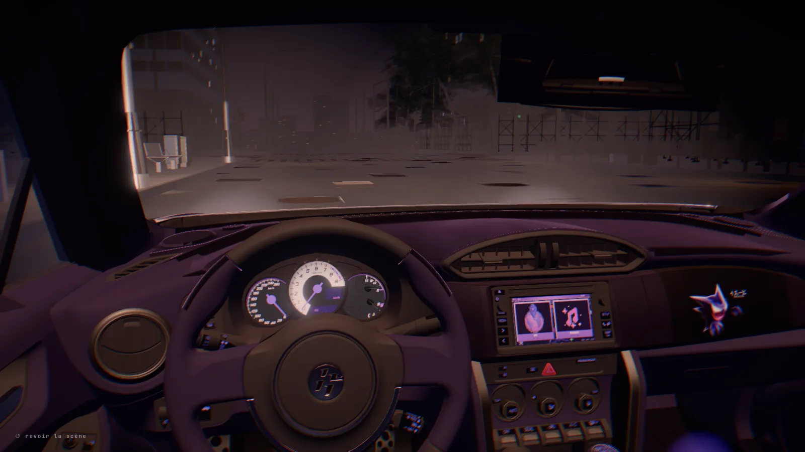
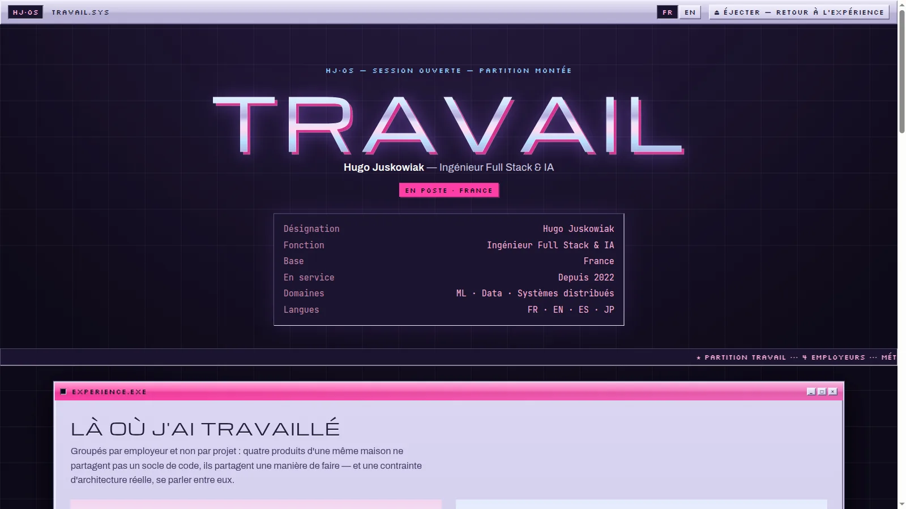
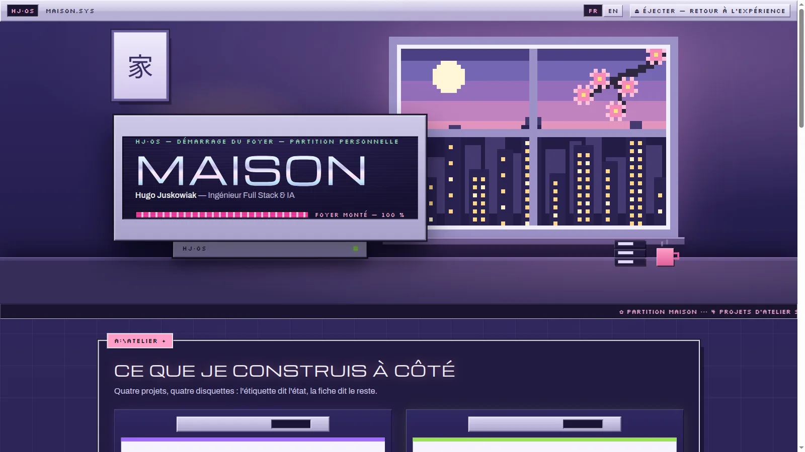

## Hugo Juskowiak: Portfolio

My portfolio, built as a place you drive into. On a desktop or tablet you land in a night city
in real-time 3D, get into a Toyota GT86 and use its dashboard screen to choose between two
rooms: **Work** (the office: employers, method, contact) and **Home** (the bedroom: personal
projects and studies). Each project then opens as its own Y2K-style poster page. The whole
site is in French and English.

- Live: <https://www.hugojuskowiak.com/>







---

The rest of this file is for developers.

### Tech stack

| | |
|---|---|
| Framework | Next.js 16 (App Router, Turbopack), React 19.2, TypeScript |
| 3D | `three` 0.169.0, `@react-three/fiber` 9.7.0, `@react-three/drei` 10.7.8 |
| Styling | Hand-written CSS + Tailwind CSS v4 as a base layer only |
| Asset pipeline | `@gltf-transform/*`, `meshoptimizer`, `sharp` (dev only) |
| Browser checks | Chrome driven over CDP by `tools/chrome.mjs` (no npm dependency) |
| Analytics | `@vercel/analytics` |
| Hosting | Vercel |

**What this project does *not* use**: no CMS, no shadcn/ui, no Radix, no icon library, no UI
kit. Every string and every record is checked into the repository. Each world writes its own
CSS by hand.

### Getting started

```bash
npm install

npm run dev            # http://localhost:3000

npm run build          # production build (runs tsc)
npm start
```

Node 24 or newer is needed for `npm run gt86`, which imports `.ts` files directly.

### How the site is put together

The server always renders a complete page that works without JavaScript and without 3D. That
page gets indexed. If the 3D can't run, visitors get this page and nothing else. The 3D
experience is then laid over it on the client. It only mounts when the visitor's device can
run it. It removes itself on any error.

- **Capability gate**: `components/gt86/capable.ts`. The 3D mounts only if the viewport is at
  least 768 px wide, WebGL2 can be created and `prefers-reduced-motion` is not set. Phones and
  browsers without WebGL get a lighter version with no 3D. This file never imports three or
  R3F, so the 3D bundle stays behind a `dynamic(ssr: false)` in `components/gt86/surcouche.tsx`.
- **State machine**: `components/gt86/machine.ts`. The scenes run in this order: sky → landing
  → threshold → cabin → GPS / music → departure to `/work` or `/home`. The file is pure (no
  React, three or DOM), so the harness can check its transition table in Node.
- **Y2K world**: `components/y2k/`. This holds the two hubs (`hub-travail.tsx`,
  `hub-maison.tsx`), the poster template for project pages (`fiche-y2k.tsx`) and the pixel art.
  The design tokens are in `y2k.css`. The rule here is **one accent colour per project page**.
- **Music**: the in-car player only loads Spotify after you click the music tile. Before that
  click, not a single byte is fetched from Spotify. Track previews play through our own
  `<audio>` element, so the volume knob changes the real volume. The track list comes from
  `/api/gt86/mix/[id]`. That route is limited to four mixes. If it fails, it returns an empty
  list and the page falls back to a link.
- **CRT filter**: `components/filtre-crt.tsx`. An optional scanline overlay drawn over every
  route, including the 3D canvas. It is off by default. Turn it on with `?crt`, or with the
  toggle in the car. The choice is saved in `localStorage`.

The architecture spec explains the design choices behind all of this:
[`docs/superpowers/specs/2026-08-13-gt86-architecture.md`](docs/superpowers/specs/2026-08-13-gt86-architecture.md).

### Project structure

```
app/
  page.tsx             entry: server-rendered page + the 3D overlay
  work/                the office hub
  work/[slug]/         one page per job project (3 static paths)
  home/                the bedroom hub
  home/[slug]/         one page per personal project or course (6 static paths)
  api/gt86/mix/[id]/   track previews for the in-car player
components/gt86/       the 3D experience: state machine, capability gate, scenes, player
components/y2k/        the Y2K world: hubs, poster template, pixel art, y2k.css
components/proto/      shared data
  dict.ts              every visible label, FR and EN
  projets.ts           project records
  parcours.ts          employers and studies records
  mondes.ts            which page lives under /work and which under /home
components/filtre-crt.tsx
public/prototype/      3D assets: gt86.glb, decor-*.glb, crepuscule.hdr, textures
tools/gt86/verifie.mjs the harness (see below)
tools/monde/           GLB pipeline: crop the city, size textures by distance, GPS map layer
tools/pixel/           generates components/y2k/pixel-art.ts from code (same output every run)
tools/banc/frame.mjs   frame-budget bench (threshold in tools/banc/SEUIL.md)
tools/chrome.mjs       finds and drives Chrome over CDP, no npm dependency
```

### Checks

```bash
npm run gt86           # block A: state machine, repository guards, assets (instant, Node only)
npm run gt86 -- --nav  # + block B: builds, runs `next start`, drives a real Chrome
```

Block B is the most important check in the repo. It confirms that:

- the server render stays intact
- the overlay mounts and unmounts cleanly
- the car's dashboard screen responds end to end
- nothing is fetched from Spotify before the click
- devices that can't run 3D still get the full page
- the site makes no external requests

### Conventions

These are enforced in code review, not by a linter.

- **No visible string inside a component.** Labels go in `dict.ts`, records in `projets.ts` /
  `parcours.ts`, always in FR **and** EN.
- **No invented facts.** A project page only states what is true.
- **`prefers-reduced-motion: reduce` turns off every animation.** It also keeps the 3D
  experience from mounting at all.
- **Frame budget: 8.3 ms** (120 Hz). Anything new is measured against it with
  `npm run banc -- <url> <label> --tete`. You can't skip `--tete`: headless Chrome composites
  in software and can't tell you anything about 120 Hz. Results are compared as *the % of
  frames over 8.3 ms, at the same minimum frame rate*. The alert threshold and the reasoning
  behind it are in `tools/banc/SEUIL.md`.
- Code comments are in French and explain *why*, not *what*.

### Contact

- Email: <mailto:hugo.jskpro@outlook.fr>
- GitHub: <https://github.com/Zokuzo>
- LinkedIn: <https://www.linkedin.com/in/hugo-juskowiak/>
