# Hugo Juskowiak: Portfolio

My portfolio, built as a drive. On a desktop or tablet, a white Toyota GT86 falls out of a dusk
sky into a night city in real-time 3D, you sit in the driver's seat, and a menu in the style of
Need for Speed takes you to **Work** (employers, method, contact) or **Maison** (personal
projects and studies). On a phone, and on any machine that can't run the 3D, the same content is
served as a 2D app. Each project then has its own Y2K-style poster page.

- Live: <https://www.hugojuskowiak.com/>

### The experience (desktop)

On a desktop or tablet (viewport of 768 px or more), `/` plays this sequence. The intro runs once
per browser session: a second visit in the same session opens straight in the cabin.
*Passer l'intro* (bottom right) is offered from the sky to the threshold and jumps to the cabin.
The 3D experience is in French.

**1. The sky.** The GT86 hangs nose down over a pink dusk sea of clouds. Clicking the car or
*Cliquez pour démarrer* starts the intro and its music.

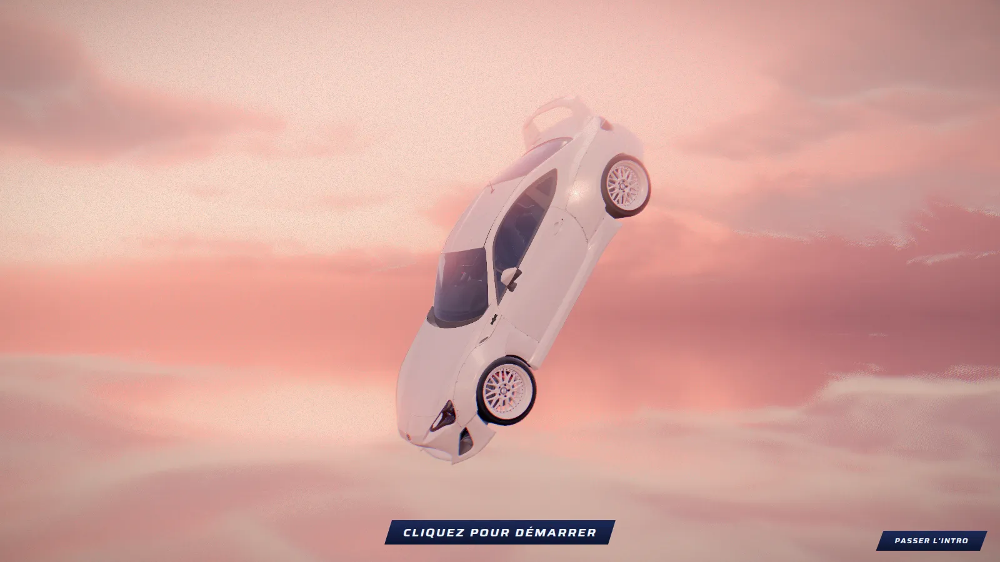

**2. The fall.** The car drops, time slows, and the frame is cut between two black oblique
bands. Four shots of the car follow, timed to the music.

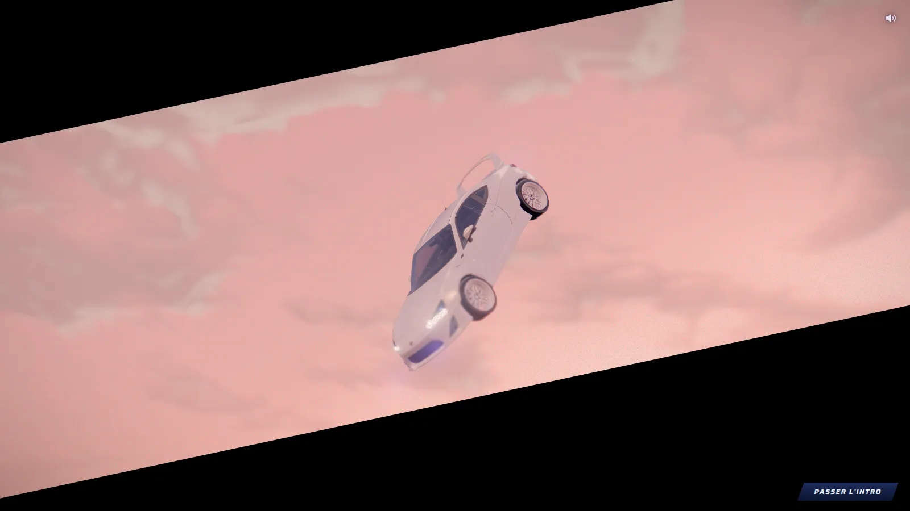

**3. The threshold.** The car lands in the night city, the headlights come on and the title card
*Hugo Juskowiak / Software Development Engineer* appears. The camera then goes through the
windscreen to the driver's seat, and the engine starts.

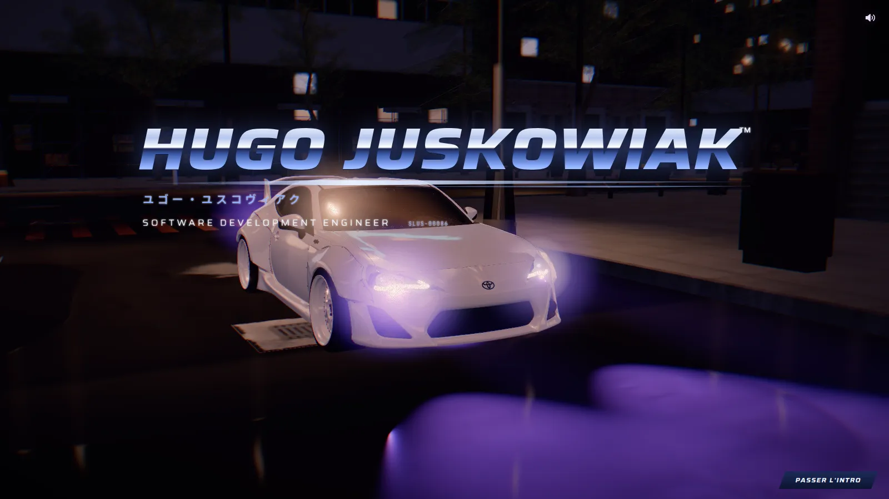

**4. The cockpit menu.** A Need for Speed style menu laid over the 3D interior: Maison, Work,
Garage, Carrière, Pilote, Radio, Options. Arrow keys and Enter, or the mouse.

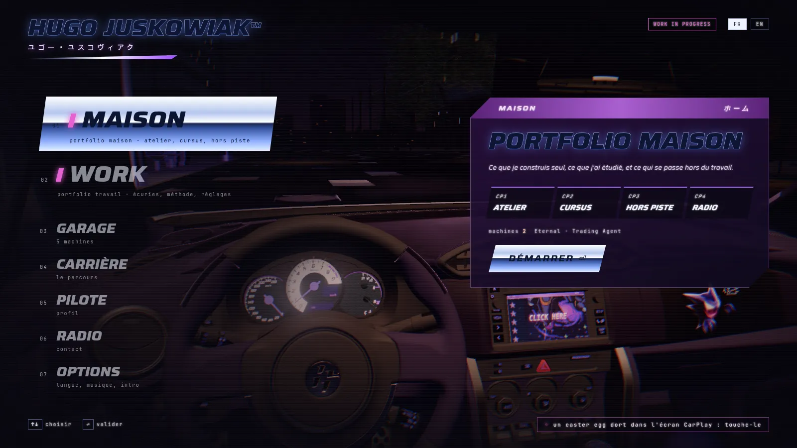

**5. The route.** Validating Work or Maison in the menu plans the route on the dashboard map, in
pink, with an ETA card. Here, Work.

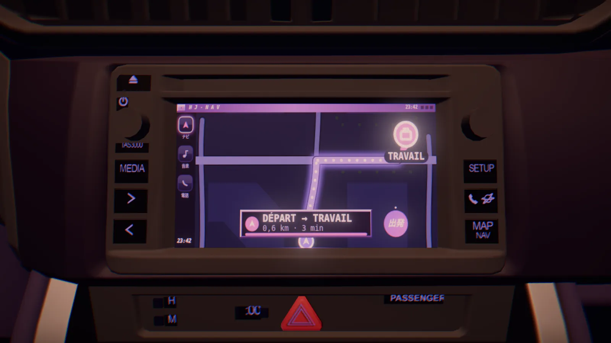

**6. The departure.** Chase camera behind the GT86 as it pulls away: first gear, second at
3.5 s, revs, speed and gear in the HUD. A slanted wipe crosses the screen at 4.8 s.

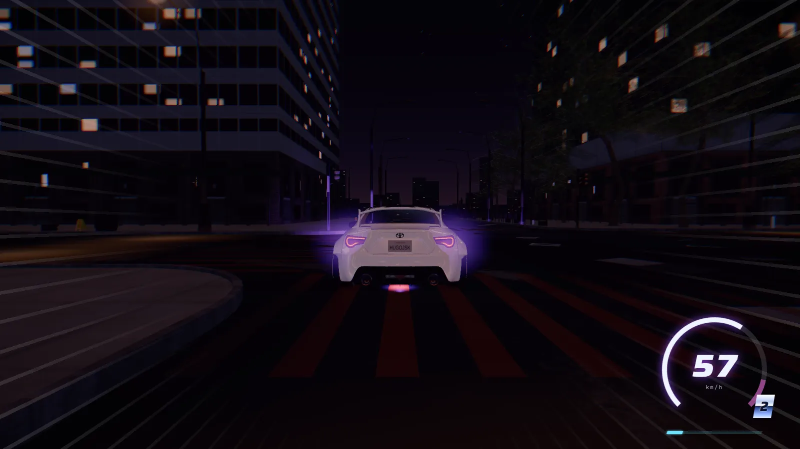

**7. The arrival.** At 5.5 s the site navigates to `/da/a/work` (or `/da/a/maison`): a race-style
page with a *‹ Garage* button back to the car and a FR / EN switch.

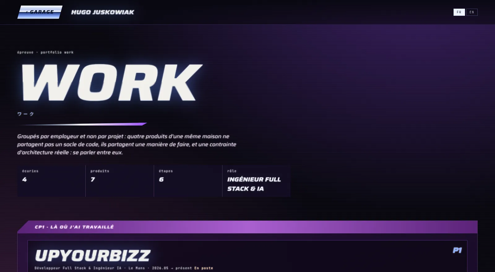

#### Detours from the menu

Neither is on the way to the departure.

**Pilote.** This menu entry shows Hugo's neon portrait and his driver licence: role, base,
languages, current team.

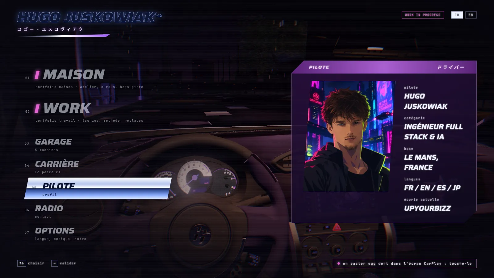

**The easter egg.** The menu footer points at it. Clicking the dashboard screen (it blinks
*CLICK HERE*) flies the camera to it and opens the HJ·OS hub, with a GPS tile and a Musiques tile.
Musiques holds a player with four Spotify mixes.

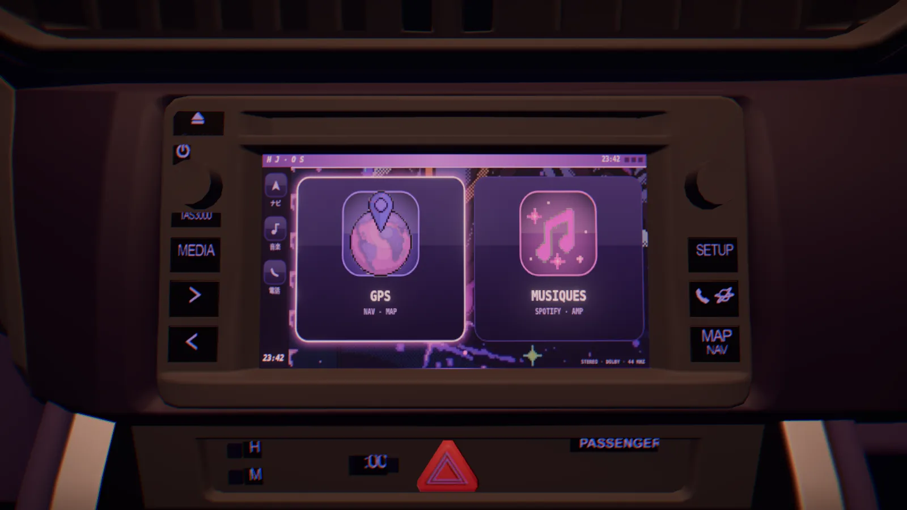

### Without 3D: the web version

`/` is always rendered on the server as a 2D app (the "fusion", `components/mobile-ab/`). The 3D
is laid over it in the browser only when the device can run it. On a desktop without 3D, that app
stays as a 440 px column centred on black.

You get this version when:

- the viewport is narrower than 768 px, or the browser reports neither a fine nor a coarse pointer
- WebGL2 can't be created, or `prefers-reduced-motion: reduce` is set
- the URL carries `?gt86=off`, or the 3D throws an error (it removes itself and leaves this page)

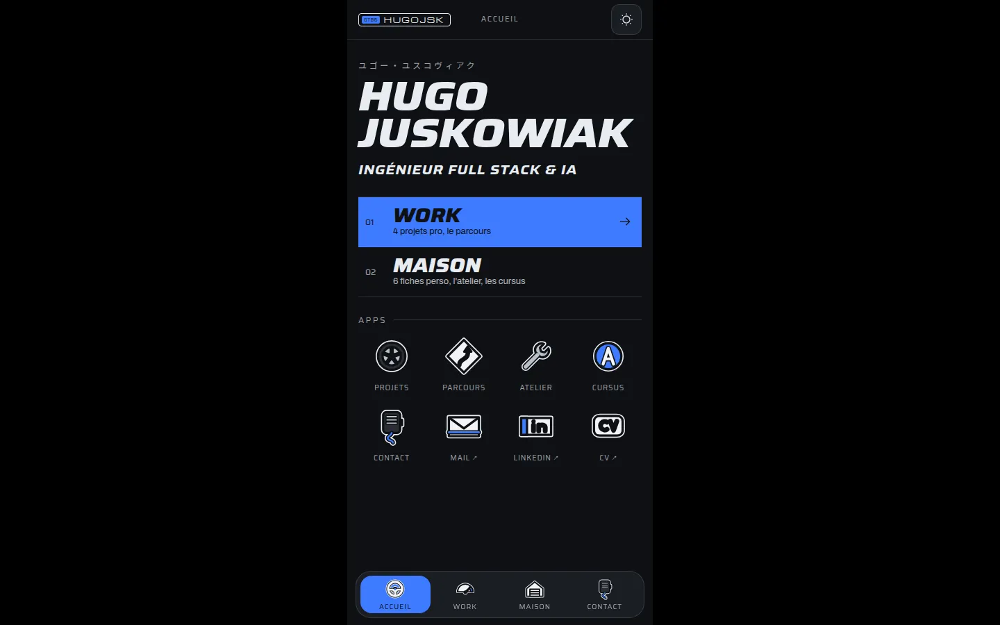

### On a phone

<table>
  <tr>
    <td>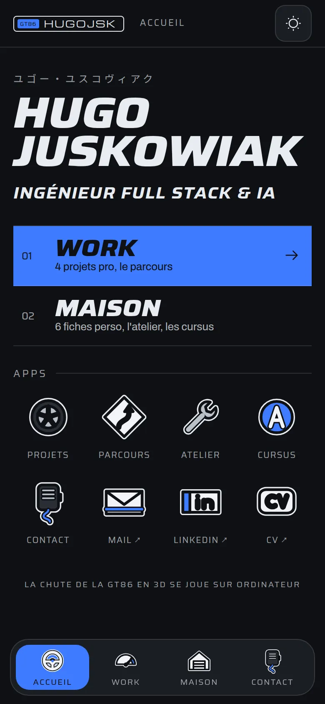</td>
    <td>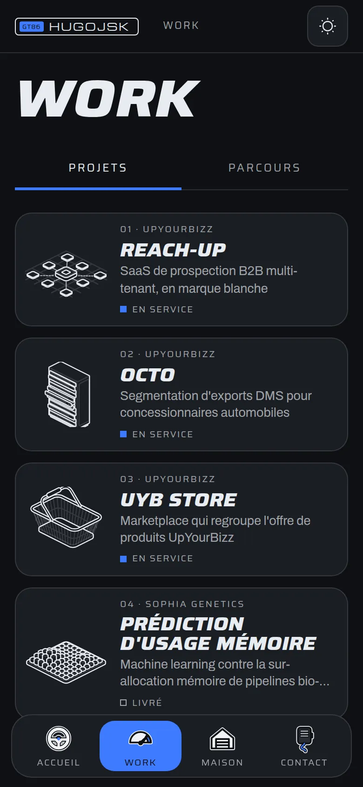</td>
    <td>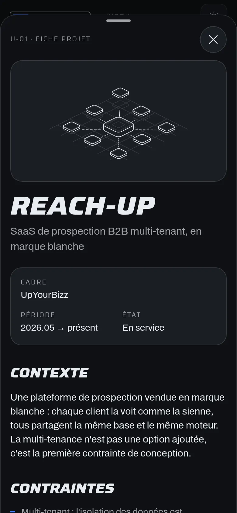</td>
  </tr>
  <tr>
    <td><code>/</code>: name, Work and Maison, eight app tiles and a four-tab dock. No 3D.</td>
    <td><code>/work</code>: Projets and Parcours tabs, four project cards with a line-art figure and a status tag.</td>
    <td><code>/work/reach-up</code> from a shared link: the project opens as a sheet with a drag handle and a close button.</td>
  </tr>
</table>

The dock switches between Accueil, Work, Maison and Contact without a reload. The URL follows
(`/work`, `/home`, `/work/<slug>`, `/home/<slug>`), so those links can be shared. A project sheet
can be dragged down or closed with Escape. The theme follows the system setting on each visit;
the button in the top bar switches it for the session. This version is in French only.

### Work and Maison

The 3D drops you on one of two arrival pages: `/da/a/work` (employers ranked P1 onward, method,
settings, Radio for contact) and `/da/a/maison` (workshop, courses, off-track, Radio). Their
project links open the project pages. The project pages and the two desktop hubs, `/work` and
`/home`, share a Y2K desktop style. Each project page links back to its hub, and typing `/work`
or `/home` opens the hubs directly. The arrival pages, the hubs and the project pages have a
FR / EN switch.

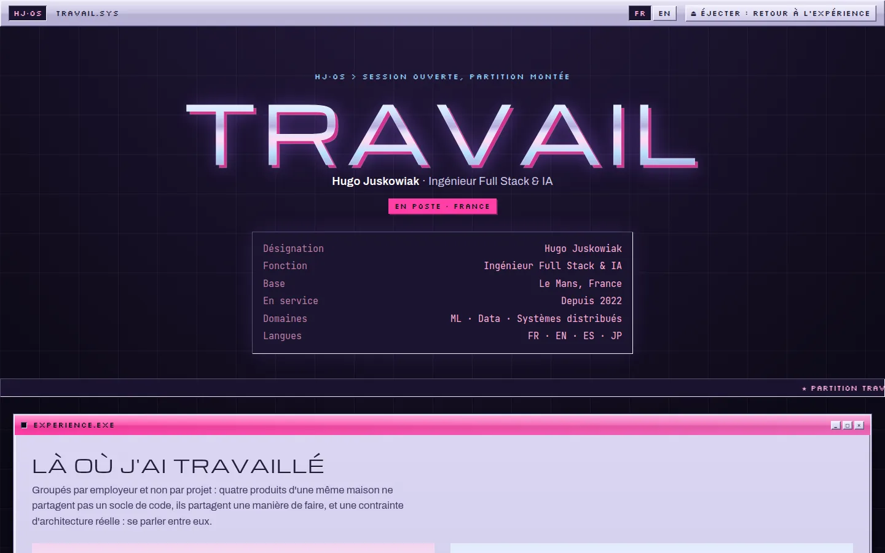

`/work`: a chrome TRAVAIL wordmark and a BIOS-style readout, then EXPERIENCE.EXE (the four
employers), METHODE.EXE, SPECS.SYS and CONTACT.DLL. The eject link in the system bar goes back to
the experience.

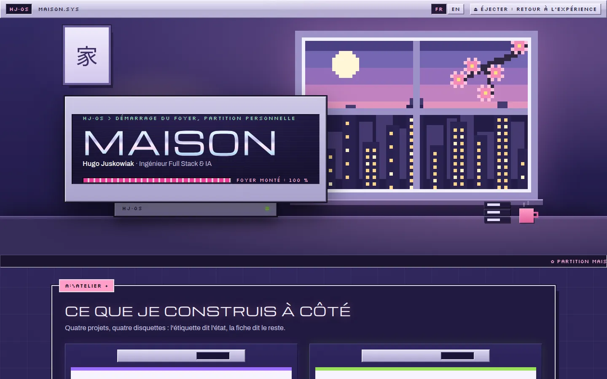

`/home`: a pixel-art bedroom at dusk with a CRT monitor carrying the MAISON wordmark, then the
workshop as four floppy disks, the four courses as an HJ·AMP playlist, PROFIL.INI and MSGR.EXE.

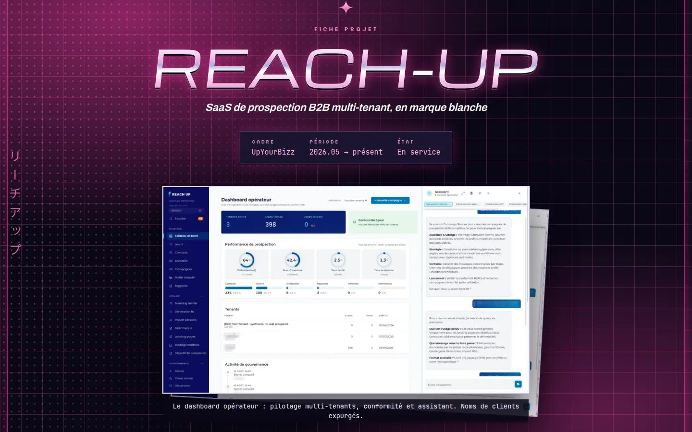

`/work/reach-up`: each project page is a poster with its own accent colour, a SYSTEM panel, then
context, constraints, decisions and results. Reach-Up also has a showcase of two product
screenshots, with client names redacted. There are ten project pages: four under `/work`
(`reach-up`, `octo`, `uyb-store`, `prediction-memoire`) and six under `/home` (`eternal`,
`trading-agent`, `cpge`, `estia`, `hokkaido`, `mbds`).

---

The rest of this file is for developers.

### Tech stack

| | |
|---|---|
| Framework | Next.js 16.3 (App Router, Turbopack), React 19.2, TypeScript 5.9 |
| 3D | `three` 0.169.0, `@react-three/fiber` 9.7.0, `@react-three/drei` 10.7.8 |
| Post-processing | `@react-three/postprocessing` 3.2.0, `postprocessing` 6.39.5: one composer (AgX, pink LUT, bloom, grain, vignette, chromatic aberration, MSAA 4), plus depth of field during the fall |
| Styling | Hand-written CSS and CSS modules, Tailwind CSS v4 as a base layer only |
| 2D app | `motion` (view and sheet animations), `reicon-react` (icons), `@lucasmarkes/hairline` (line-art figures) |
| Asset pipeline | `@gltf-transform/*`, `meshoptimizer`, `sharp` (dev only) |
| Browser checks | Chrome driven over CDP by `tools/chrome.mjs` (no npm dependency); `playwright-core` and `jiti` for the two scripts in `tools/controles/` |
| Analytics | `@vercel/analytics` |
| Hosting | Vercel |

No CMS, no shadcn/ui, no Radix. Every string and every record is checked into the repository.
`components/obsidian/` holds components copied from ObsidianUI (each file header names its
source file); `lib/utils.ts` (`cn()`, `clsx` + `tailwind-merge`) exists only so they compile. They are used by the review
boards under `/da/m/`, not by the production pages.

### Getting started

```bash
npm install

npm run dev            # http://localhost:3000

npm run build          # production build (runs tsc)
npm start
```

Node 24 or newer is needed for `npm run gt86`, which imports `.ts` files directly.

This is Next.js 16: APIs and conventions differ from older versions. `AGENTS.md` asks to read the
guide in `node_modules/next/dist/docs/` before writing code (`next dev` rewrites that block).

### How the site is put together

**One page, two layers.** The server always renders `/` in full, without 3D: the 2D app
(`components/mobile-ab/`) on its Accueil view, as a centred 440 px column on wide screens. That
page gets indexed. Moving between the app's views and opening a project sheet need JavaScript:
the dock, the tiles that open a view and the project cards are `<button>`s. The 3D experience is then laid over it on the
client by `components/gt86/intro-3d.tsx`; `surcouche.tsx` loads the scene with
`dynamic(ssr: false)`. It only mounts when the device can run it, and it removes itself on any error.

- **Capability gate**: `components/gt86/capable.ts`. The 3D mounts if the viewport is at least
  768 px wide, the pointer is fine or coarse (tablets included), WebGL2 can be created and
  `prefers-reduced-motion` is not set. Once inside, only `reduce` takes you out: resizing the
  window does not tear the scene down. This file never imports three or R3F. An inline script in
  `app/layout.tsx` repeats these checks (minus WebGL) before the first paint on `/` and sets
  `html[data-gt86="attente"]`, a dark mask lifted at the latest after 5 s, so the 2D page does
  not flash under the 3D.
- **Two bodies**: `/work`, `/home` and their project pages (`/work/<slug>`, `/home/<slug>`)
  render the desktop page and the 2D app in the same HTML (`components/mobile-ab/deux-corps.tsx`).
  The CSS keeps one of them at 768 px. No user agent sniffing. The arrival pages `/da/a/work` and
  `/da/a/maison`, and the review boards under `/da/`, have no 2D version: they render their
  desktop page only.
- **State machine**: `components/gt86/machine.ts`. States: `CIEL`, `ATTERRISSAGE`, `SEUIL`,
  `HABITACLE`, `GPS`, `CHOIX`, `MUSIQUES`, `SPOTIFY`, `DEPART`. `RAILS` lists the only chain the
  machine runs on its own: `ATTERRISSAGE` to `SEUIL` to `HABITACLE`. The scene adds one more: when
  the GPS planning on the dashboard screen ends (3.6 s, then 450 ms), it sends `confirme` itself,
  so `CHOIX` leads to `DEPART` with no gesture (`?nodepart` stops it there). Everything else waits
  for the visitor. The intro plays once per
  session (`sessionStorage` key `gt86-intro`). The file is pure (no React, three or DOM), so the
  harness checks its transition table in Node.
- **The fall**: `components/gt86/prototype-chute.tsx` renders `ATTERRISSAGE`. Despite the file
  name, it is the default since 2026-10-20. Its cue times, in seconds from the click, live in
  `CALAGE_DEFAUT` (`components/gt86/chute-physique.ts`). `?vol=ancien` replays the earlier 4.6 s
  flight from `vol.tsx`.
- **Cockpit menu**: `components/nfs/menu-nfs.tsx`, chosen in `components/gt86/scene.tsx` (look
  there, not in `components/nfs/drapeau.ts`, whose export is unused). Validating Maison or Work
  runs the 3.6 s GPS planning on the dashboard screen, then the 5.5 s trip whose score is the pure
  module `components/gt86/trajet.ts`, then `components/gt86/scene.tsx` calls `router.push` to
  `/da/a/maison` or `/da/a/work` (the `ROUTES` of `components/nfs/course.tsx`). `/work` and `/home` are the exit only under `?menu=ancien`, which
  renders the previous cabin with its dashboard choice and *revoir la scène* button.
- **Dashboard screen**: `components/gt86/ecran.ts`, a canvas painted into the 3D with eight states
  (standby, hub, GPS, music list, HJ·AMP player, clock, stats, off), front-panel buttons and a volume knob turned with
  the mouse wheel. The menu leaves it clickable.
- **Music**: nothing is fetched from Spotify before the click on the tile marked SPOTIFY. Track
  previews play through our own `<audio>` element and a `GainNode`, so the volume knob changes
  the real volume. The track list comes from `/api/gt86/mix/[id]`, limited to four mixes: 400 for
  any other id, 502 and an empty list on failure, and the screen falls back to a link.
- **Intro audio**: the intro music waits for the start click (`lanceMusique()` in
  `musique-intro.tsx`, called from the click handler). With the cockpit menu (the default), the
  engine start and acceleration sounds are preloaded when the scene mounts, before any click
  (`prechargeDemarrage()` in `demarrage.tsx`). The engine start plays when the threshold ends, in
  the cabin (`lanceDemarrage()`, called by `seuil.tsx`). The sound button
  cuts the music, the engine start and the acceleration. If `TRAJET_MS` or the trip score change,
  rerun `tools/sons/acceleration.py` (its raw source lives in `ressources/`, ignored by git).
- **Y2K world**: `components/y2k/`. The two hubs (`hub-travail.tsx`, `hub-maison.tsx`), the
  poster template for project pages (`fiche-y2k.tsx`) and the pixel art. Design tokens are in
  `y2k.css`. The rule here is **one accent colour per project page**.
- **Languages**: the 3D overlay is mounted in French, and the cockpit menu's FR / EN pills are
  decorative for now. The 2D app is French only. The arrival pages, the hubs and the project
  pages have a working FR / EN switch, kept in local state (not remembered). The served HTML is
  French and slugs are not translated.
- **CRT filter**: `components/filtre-crt.tsx`. A scanline overlay over every route, the 3D canvas
  included. Off by default; `?crt` or the CRT button of the in-car player turns it on, and the
  choice is saved in `localStorage` (`gt86-crt`).
- **Redirects** (308, `next.config.mjs`): `/work/prospector` to `/work/reach-up`, and
  `/work/(eternal|trading-agent|cpge|estia|hokkaido|mbds)` to `/home/:slug`.

The architecture spec explains the design choices behind the 3D layer:
[`docs/superpowers/specs/2026-08-13-gt86-architecture.md`](docs/superpowers/specs/2026-08-13-gt86-architecture.md).
Research notes are in [`docs/recherches/`](docs/recherches/).

#### URL parameters

| Parameter | Effect |
|---|---|
| `?gt86=off` | 2D version only |
| `?gt86=boom` | makes the 3D throw on mount (tests the fallback) |
| `?menu=ancien` | previous cabin: dashboard screen choice, exit to `/work` or `/home` |
| `?vol=ancien` | previous 4.6 s flight instead of the fall |
| `?calage=ecran:2.29,a:4.12,...` | sets the fall cue times and shows a music-time banner; `&dof=0` turns off its depth of field |
| `?nodepart` | freezes the route on the dashboard (for captures) |
| `?fps` / `?ips` | drei `Stats` / frame counter (60 Hz budget, a stutter is a frame over 25 ms) |
| `?crt` | CRT filter on (remembered) |
| `?dpr=1\|1.25\|1.5`, `?msaa=2`, `?police=`, `?robe=noir` | render resolution, MSAA samples, title font, car paint |
| `?palette=`, `?theme=light\|dark`, `?icones=chrome\|pixel\|garage` | 2D app: palette, theme (not remembered), icon family |

JS handles for the console: `window.__gt86`, `__gt86ecran`, `__gt86cockpit`, `__nfs`,
`__gt86chute`.

### Project structure

```
app/
  page.tsx             entry: the server-rendered 2D app + the 3D overlay
  work/                the office hub (Y2K)
  work/[slug]/         one page per job project (4 static paths)
  home/                the bedroom hub (Y2K)
  home/[slug]/         one page per personal project or course (6 static paths)
  da/a/work/           arrival page for Work: where the 3D sends you
  da/a/maison/         arrival page for Maison
  da/a/, da/a/mobile/, da/m/*   review boards (menu without 3D, mobile variants, palettes, icons);
                       served by the build, linked from nowhere
  api/gt86/mix/[id]/   track previews for the in-car player (+ api/gt86/embed-spotify.ts)
components/gt86/       the 3D experience: state machine, capability gate, scenes, fall, player
components/nfs/        cockpit menu, trip HUD, arrival pages, synthesized UI sounds
components/y2k/        the Y2K world: hubs, poster template, pixel art, y2k.css
components/mobile-ab/  the 2D app ("fusion"): phone site and no-3D fallback
components/mobile-a/   line-art figures reused by the 2D app
components/obsidian/   components copied from ObsidianUI, for the review boards
components/proto/      shared data
  dict.ts              visible labels, FR and EN
  projets.ts           project records
  parcours.ts          employers and studies records
  mondes.ts            which page lives under /work and which under /home
components/filtre-crt.tsx
lib/utils.ts           cn() for the ObsidianUI components
public/prototype/      3D assets: gt86.glb, decor-procedural.glb, crepuscule.hdr, ciel-4k.avif, textures
public/musique/        intro music excerpt
public/sons/           engine start and acceleration
public/da/a/           pilot portrait and menu backgrounds
public/amp/, public/reach-up/, public/voiture/draco/, CV_Hugo_Juskowiak_FR.pdf
tools/gt86/verifie.mjs the harness (see below)
tools/banc/            frame.mjs (frame budget, threshold in SEUIL.md), intro.mjs (intro frames)
tools/controles/       checks for the computed diagram (components/proto/schema.tsx)
tools/monde/           GLB pipeline: crop the city, size textures by distance, GPS map layer
tools/pixel/           generates components/y2k/pixel-art.ts from code (same output every run)
tools/sons/            acceleration.py, rebuilds the acceleration sound
tools/chrome.mjs       finds and drives Chrome over CDP, no npm dependency
```

### Checks

```bash
npm run gt86           # block A: state machine, trip score, repository guards, assets (Node only)
npm run gt86 -- --nav  # + block B: builds, runs `next start`, drives headless Chrome
```

Block A also checks that every destination route exists on disk, `/da/a/maison` and
`/da/a/work` included. Block B is the most important check in the repo. It confirms that:

- the server render stays intact, and the overlay mounts with a single WebGL context
- clicking the car, skipping, the once-per-session intro and replaying all work
- the dashboard screen goes from hub to GPS to a destination and back with Escape
- nothing is fetched from Spotify before the click, and the site makes no external requests
- `?gt86=off`, `?gt86=boom` and a 390 x 844 phone get the full 2D page, with no canvas

The cabin passes run under `?menu=ancien`: block B does not click the cockpit menu.

The two scripts in `tools/controles/` (rendered geometry and guards of the computed diagram in
`components/proto/schema.tsx`) are run by hand; no npm script calls them.

Benches:

```bash
npm run banc -- <url> <label>   # frame cost per frame, headless by default, --tete opens a window
npm run banc:intro              # intro frames, 3 cold runs; --sans-tete for headless gl-egl
```

Headless Chrome composites in software: its timings only compare two versions with each other.
Absolute frame timing is read with `?ips` in a normal browser.

### Conventions

These are enforced in code review, not by a linter.

- **No visible string inside a component.** Labels go in `dict.ts`, records in `projets.ts` /
  `parcours.ts`, in FR **and** EN. `components/nfs/` does not follow this yet: its labels are
  written in French in the components, and `components/nfs/contenu.ts` is a frozen French copy
  of the records (also read by the 2D app).
- **No invented facts.** A project page only states what is true.
- **`prefers-reduced-motion: reduce`** keeps the 3D from mounting and turns off CSS animations and
  transitions. The `motion` animations of the 2D app still play: there is no `MotionConfig` yet.
- **Frame budgets.** The 3D experience targets 60 frames per second, 16.7 ms a frame, since #42:
  the `?ips` counter and the render resolution choice (`components/gt86/dpr.tsx`) use it. The
  frame bench (`npm run banc`, `tools/banc/frame.mjs`) keeps its own threshold of 8.3 ms
  (120 Hz): its results are compared as *the % of frames over 8.3 ms, at the same minimum frame
  rate*. The alert threshold and the reasoning behind it are in `tools/banc/SEUIL.md`.
- **No em dash** (U+2014) anywhere: site, code, docs, tickets, commits. No check enforces it.
- Code comments are in French and explain *why*, not *what*.

### Credits

- 3D car: ["Fox's Rocketbunny GT86"](https://sketchfab.com/3d-models/foxs-rocketbunny-gt86-815691bbc8cd459fb0fafea2d7a02df7) by [Swiss_Fox](https://sketchfab.com/Swiss_Fox), licensed under [CC BY 4.0](https://creativecommons.org/licenses/by/4.0/). Compressed and re-materialled for the web.
- 3D city: ["Procedural City 5"](https://sketchfab.com/3d-models/procedural-city-5-c2a33cf0165b497cabd5e4a22599277b) by [abhayexe](https://sketchfab.com/abhayexe), Sketchfab Standard licence.
- Sky: `qwantani_dusk_2_puresky` from [Poly Haven](https://polyhaven.com/), CC0. Two files: `public/prototype/crepuscule.hdr` (1k, lighting) and `public/prototype/ciel-4k.avif` (4096 x 2048 sky dome, from the 4k HDR).
- Intro music (`public/musique/vision-debut.m4a`): "VISION (Slowed)" by UdieNnx, HXVSAGE and Duduzinho. Excerpt from 13.92 s to 48.42 s, cut by Hugo. Not under a free licence: all rights belong to the artists.
- Acceleration (`public/sons/acceleration-gt86.m4a`): ["FR-S BRZ GT-86 Vortech Supercharged Dyno Run"](https://freesound.org/people/dezoris/sounds/191194/) by [dezoris](https://freesound.org/people/dezoris/), [CC BY 4.0](https://creativecommons.org/licenses/by/4.0/). Rebuilt into a 5.65 s run with one gear change by grains taken from the 4th-gear pull (`tools/sons/acceleration.py`).
- Engine start (`public/sons/demarrage-libre.m4a`): ["subaru impreza start up-idle-launch limiter.wav"](https://freesound.org/people/t33kno/sounds/369797/) by [t33kno](https://freesound.org/people/t33kno/) (2003 Subaru Impreza, EJ20 boxer), [CC0](https://creativecommons.org/publicdomain/zero/1.0/). First 4.2 s, mono, faded and loudness-normalised.
- Pilot portrait (`public/da/a/pilote.webp`): provided by Hugo.
- Images provided by Hugo, source not documented in the repo: `public/amp/icone-gps.jpg` and `icone-musiques.jpg` (GPS and music icons), `public/da/a/1-ciel.jpg` to `4-habitacle.jpg` (menu backgrounds).
- Third-party characters and marks, provided by Hugo, source not documented in the repo, under the rights of their owners: the Kirby logo and a Kirby sprite (`public/amp/kirby-logo.jpg`, `kirby-sprite.jpg`, the player disc art), an artwork of Haunter, a Pokémon (`public/prototype/haunter-dash*.jpg`, passenger-side dashboard), and a pixel art of a shiny Rayquaza, a Pokémon (`public/prototype/ecran-fond.jpg`, the dashboard screen wallpaper).
- Draco decoder (`public/voiture/draco/`): from [google/draco](https://github.com/google/draco), [Apache License 2.0](https://github.com/google/draco/blob/master/LICENSE). Byte-for-byte copy of the build shipped in `three` (`examples/jsm/libs/draco/gltf/`); no GLB uses Draco today.
- Cockpit menu UI sounds are synthesized with Web Audio, no files.
- Fonts from Google Fonts through `next/font` (self-hosted at build): Archivo, JetBrains Mono, Noto Sans JP, Saira, Michroma, Silkscreen.

### Contact

- Email: <mailto:hugo.jskpro@outlook.fr>
- GitHub: <https://github.com/Zokuzo>
- LinkedIn: <https://www.linkedin.com/in/hugo-juskowiak/>
